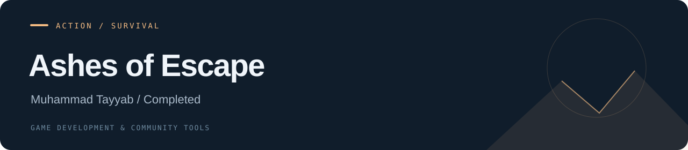

# Ashes of Escape

**Action / Survival · Completed**

An independent 3D action / survival game built around escape and extraction, combining survival-action gameplay with atmospheric environments.

| Project | Details |
| --- | --- |
| Developer | Muhammad Tayyab |
| Progress | Completed |
| Tools / focus | Unity · C# · Blender |
| Repository contents | Project documentation and repository configuration |

## Project focus

- C# gameplay mechanics, interaction systems and player controls.
- AI behaviors and the core gameplay loop.
- Custom environments, weapons and character assets.
- Blender models and animations integrated into Unity.
- Atmospheric level design.

## Repository status

The game is completed. This repository is its project showcase; source code and a playable build have not been uploaded.

## Media

See the [media guide](./media/README.md) for the project captures to add.

## Source project

The [source import guide](./docs/ADDING_SOURCE.md) describes the repository layout for adding the real Unity project.

---

[All projects](https://github.com/tabi-malikx) · [Project catalogue](https://github.com/tabi-malikx/tabi-malikx#selected-projects)
